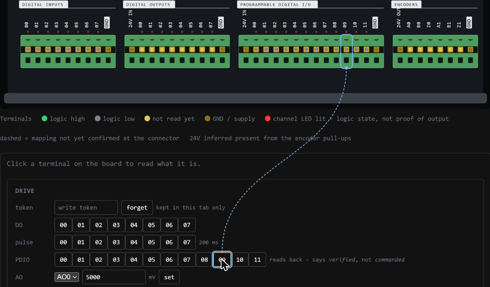

# Portenta Machine Control Explorer

A browser-served diagnostic panel for the Arduino Portenta Machine Control
(AKX00032), running native Zephyr with dual-slot MCUboot updates over WiFi.

## Why

The Machine Control is a capable industrial carrier — 8 digital inputs, 8
high-side digital outputs, 12 programmable digital channels, 3
software-configurable analog inputs, 4 analog outputs, 3 temperature channels,
2 encoders, RS485/RS232, CAN, RTC — and it is **poorly documented**. The
datasheet gives connector tables and ratings but not operational procedure: it
does not say how an analog input's 0-10 V / 4-20 mA / NTC mode is selected,
what the latch pins do, or how three temperature channels share one SPI bus
between two different front-end chips.

The only real documentation is the `Arduino_PortentaMachineControl` library,
which is mbed-only — a core Arm declared end-of-life in July 2026.

So this is an instrument for making the hardware legible: a panel that reads
and writes every named channel, with the names an Arduino user already knows,
and a repository that records how each fact was established. Every claim here
is tagged by how much it is worth trusting — see
[the documents](#the-documents).

## Status



Hovering a control draws a line to the terminal it drives, so the association
between a button and a screw terminal is visible rather than remembered. The
terminals are found by the same `?ch=<name>` key the firmware's allow-list
uses, so a channel that can be clicked can be linked, with no second list to
keep in step.

Working on hardware:

| | |
|---|---|
| Boot chain | Arduino bootloader → MCUboot → Zephyr, all verified on the board |
| Flash map | Custom, dual-slot, confirmed against the running image with `pmc parts` |
| OTA | Upload, swap and boot over WiFi, proven end to end |
| Discovery | `portentaexplorer.local` |
| Reads | 8 digital in, 12 programmable digital I/O, 3 analog in updating every 2 s |
| Writes | 8 digital out (level and pulse), 12 PDIO, 3 analog out — token-gated |
| Supply | 24 V *inferred* from all six encoder inputs reading high — why they read high is unestablished and the negative case is untested, so the lamp has a cannot-tell state and [MEASURED.md](docs/MEASURED.md) carries the measurement that would settle it. 3V3 is lit because running code proves it; 12 V is sensed by nothing and says so |
| Clock | PCF8563 set from NTP, carried through power-off by the on-board supercap |
| Serial | RS485 proven end to end into its own jumpered pair, Modbus RTU frames built with the CRC computed; RS232 and all eight control lines driven from the panel |
| Temperature | Three channels across two converters sharing one bus and one mux, read as a rotation rather than a snapshot, with the converter's own fault word rendered |
| Encoders | Both channels armed and decoded in software, 4x, counting edges, rate, Z index pulses and illegal transitions. ENC1 confirmed against a real encoder turned by hand; ENC0 not yet |
| CAN | FDCAN1 at 500 kbit/s, a 32-frame receive window with a cursor, a repeating transmitter, and a minimal CANopen node with its own self-test — all of it proven in internal loopback, which touches nothing past the MCU |
| Panel | Rendered on the board from `web/index.html`, with a drawing of the carrier whose terminals carry live state |

**Each write says only what it can prove.** A digital output reports
`commanded`, because that family has no sense path and nothing on the board
can confirm it. A programmable channel reports `verified`, having pulsed the
latch and read the same channel back as an input — or `no supply`, when it
reads low with no fault flag, which means the `24V IN` terminal is unfed
rather than that anything failed. An analog output reports the value it set,
and says the volts-per-count is derived rather than measured.

**What is left is mostly hardware, not code.** Every family above is built and
served, and most of them have still never had anything on the other end of the
terminal. No probe has been connected to a temperature channel, and CAN has
never received a frame off a wire — one node cannot acknowledge its own frame,
and the loopback that works is internal. Exactly one channel has been confirmed
at the connector with a meter, which is why the rest of the board drawing
renders dashed: the expander channel maps are transcribed, not proven here.

**The encoders are the exception, as of 2026-11-24.** An encoder was turned by
hand on ENC1 — ground, A and B — and the count follows the movement in both
directions and returns to the same value after a there-and-back turn. ENC0 has
still never counted, the Z index line has never been connected on either
channel, and turning slowly reports a velocity of zero while the count keeps
updating, which is integer truncation in a 2-second sample window rather than a
fault. The details and what they do not settle are in
[docs/MEASURED.md](docs/MEASURED.md).

Each of those gaps names the thing to connect and the number that settles it,
in
[the TBD list](docs/MEASURED.md#tbd---measurements-this-board-is-wired-for-and-has-not-taken).
Nothing in that section may be cited as evidence.

### The panel is a template the board renders, not a page a script assembles

It is server-side includes, through the [HtmlTpl][lib] engine shared with a
sibling project on this bench. The page is authored as `web/index.html` and
opens in a browser as a file;
`tools/gen_page.py` checks every `<!--#v name-->` in it against the registry
in `app/src/page_vars.cpp` and emits the committed header the firmware
serves. A name the registry does not have is a build error naming the line.

Two consequences worth stating, because each replaced something worse:

- **Every reading on the page comes from one instant.** The renderer takes a
  single snapshot before the first row is asked for, which is what makes the
  sentence in the page's own heading true. Nothing polls; reload to take a
  fresh set.
- **One script, and it talks to nobody.** The clock marker is rendered by the
  board, digits and all, and a few lines at the end of the page advance them
  from the browser's own elapsed time. It issues no request, so the page still
  takes every reading in one pass and still never polls. With the script
  removed the marker shows the time the board held when it rendered.
- **The board drawing is one terminal, written once.** All 79 are the same
  markup inside an `each` block, and `tools/gen_board.py` solves where each one
  sits from `tools/terminals.csv`. That is also the only way the hover tips can
  be live: 79 terminals cannot be 79 registry variables.

[lib]: https://github.com/NoahChristian/Arduino_HTTP_HTML

## Hardware

The board has **no display and no software-controllable LED** — the only LED
the datasheet mentions is a hard-wired power indicator that does not change on
reset. So the USB CDC-ACM shell and the web panel are the only two ways to see
anything at all.

A boot indicator on `DO1` used to be the third, and it was **removed**: an
output the firmware strobes cannot also be a channel somebody sets and expects
to find where they left it, and DO1 would have been the one output that
silently refused to keep its state. What that gave up is recorded in
[docs/MEASURED.md](docs/MEASURED.md) — after a reset nothing on this board now
distinguishes "running but not yet healthy" from "in the DFU bootloader" from
"unpowered" unless the network is up. `dowalk` still lights each of the eight
outputs in turn, which is the measurement that settles the channel map.

It also has **no BOOT0 button, no SWD header and no JTAG header**. Its
topology table lists exactly one button, `PB1 RESET`, and the Portenta H7's own
schematic has exactly one too. BOOT0 exists only on the H7's high-density
connector, which the carrier occupies. That single fact shapes the whole
install path — see [docs/MEASURED.md](docs/MEASURED.md).

## The secure element, and why this project does not touch it

The Machine Control datasheet lists an **NXP SE0502 secure element**, and the
Portenta H7 schematic carries a `Cryptochip` sheet with both an `SE050C2HQ1`
and an `ATECC608A` — alternates across board revisions. Zephyr's board
definition describes neither, and an I2C scan here found neither at its default
address (0x48 for the SE050, 0x60 for the ATECC608), so which part is fitted
and where it sits is an open question.

**This project deliberately leaves it alone**, for two reasons. The second is
the interesting one.

The first is that the damage would be permanent. The ATECC608's config and
data zones lock **once, irreversibly**. An open-source exploration tool has no
business bricking a capability its users may want later, and "we only meant to
look" is not a recovery plan.

The second is that the part is sold as a feature of the board and is largely
not yours. It is advertised as the secure element that makes this a secure IoT
device, and then the vendor's own cloud provisioning claims its configuration
for an identity tied to their subscription service. There is a legitimate
engineering reason for that — a device identity a cloud can trust has to be
provisioned somewhere trustworthy, and the factory is the obvious place — but
the effect is that a hardware capability you paid for arrives with someone
else's key in it, and taking it back is a one-way door that forecloses the use
it was advertised for. Good engineering, annexed by a licensing model.

Worth being clear-eyed about, because it changes what the part is *for* on a
board like this one: not a general-purpose key store you happen to own, but a
vendor identity anchor you may borrow. That is a different component, and it
should be reasoned about as one.

What it would buy, if that trade were ever worth making, is narrower than it
first appears:

- **Not image verification.** MCUboot verifies with a *public* key, which needs
  integrity rather than secrecy, and compiling it into the bootloader already
  provides that. A secure element adds very little here.
- **Image encryption**, which is the real argument. MCUboot's ECIES mode puts a
  *private* decryption key on the device. That is a genuine secret, and today
  it would sit in flash — readable over DFU, because the Arduino bootloader
  marks only sector 0 read-only and leaves the rest readable.
- **Anti-rollback**, where a hardware monotonic counter beats a flash-backed
  security counter.
- **Device identity** for mutual TLS to an update server.

And for a fleet, the thing that matters most is **per-device keys rather than a
shared secret**. A secure element is good at exactly that — a key that cannot
be copied off the part. But trusting the *factory* cert chain is weaker than it
sounds, because any board carrying that chain would authenticate. Fleet
separation has to come from keys you control, not from the vendor's.

This project gets its cross-device separation from a **per-project MCUboot
signing key** instead, which costs nothing and is reversible: an image signed
for another board on this bench is refused here, proven with `imgtool verify`
in both directions. See [docs/OTA.md](docs/OTA.md).

## External dependencies

Two, both public, both pinned — and the pin is **enforced**, not described.

| Depends on | Required | Enforced by |
|---|---|---|
| [whoami-spec](https://github.com/NoahChristian/whoami-spec) | **v0.8.0** | `app/src/whoami_core.{c,h}` are vendored and carry the SHA-256 of the original bytes in their headers; an edit here no longer matches the release |
| [Arduino_HTTP_HTML](https://github.com/NoahChristian/Arduino_HTTP_HTML) | **v0.11.0 or newer** | `check_engine_version()` in `tools/gen_page.py` reads the engine's `library.properties` and refuses to generate against an older one |

Neither is a submodule. `whoami-spec` is **vendored** — the two files are copied
in, so this repository builds with no sibling checkout. `Arduino_HTTP_HTML` is a
**path dependency**, because the panel is a template the board renders rather
than markup assembled in C, so the generator is not optional.

**Why the floor is v0.11.0, and why not 0.10.0.** Generated headers include
`<HtmlTplPort.h>`; older engines emitted `<Arduino.h>`. That change landed in
the engine under version **0.9.2** -- the same version the two commits before it
carried -- so 0.9.2 is an **ambiguous version**: two different output behaviors
answer to one number, and a floor naming it would admit the half that does not
work here.

0.10.0 is where the seam and the Zephyr adapter actually arrived, and it would
be the honest technical floor. It is not the floor because **it was never
tagged.** The engine bumped `library.properties` four times -- 0.9.1, 0.9.2,
0.10.0, 0.11.0 -- and released none of them until v0.11.0. A floor naming a
version with no tag cannot be checked out, downloaded or referenced; it is a
description of a string in somebody's working tree.

So the floor is the oldest version that exists as a release. It is marginally
stricter than the code requires, and that is the price of being obtainable.

## Building

> **There is no binary in the release repository — you will need to build it.**

Not for secrecy: the image has carried no secret since 0.8.0, and that was
verified by a byte scan with a control. It is because a *usable* binary would
have to come with a bootloader holding **this project's** public key, which
would make this project the signing authority on your board. You generate your
own key instead, below, and nothing here is ever asked to sign for you.

Needs a Zephyr west workspace, the Zephyr SDK, and a checkout of
**Arduino_HTTP_HTML** beside this repository — see the table above.
Override its location with `-DHTMLTPL_DIR=<path>` or `$env:HTMLTPL_DIR`.

Every argument in the build script was arrived at by a build failing in a way
that did not name the cause, which is why there is a script rather than a
command to copy:

```powershell
python tools/gen_board.py       # only after editing tools/terminals.csv
python tools/gen_page.py        # only after editing web/ or the registry
pwsh tools/build.ps1            # application only
pwsh tools/build.ps1 -Mcuboot   # bootloader too; needs its own signing key
```

Both generated files are **committed**, so the firmware builds without Python;
the pre-commit hook runs each generator with `--check` so a stale one cannot
reach a commit. A stale generated page compiles clean, flashes clean, and
serves the previous page.

Pinned toolchain, because the HTTP server is marked experimental upstream and
several Kconfig symbols moved recently: Zephyr 4.5.99, SDK 1.0.1,
arm-zephyr-eabi gcc 14.3.0.

### Your own signing key, before the first bootloader build

MCUboot verifies every image against a public key compiled into the
bootloader. Generate the pair once, keep the private half outside every
repository, and **you are your own signing authority** — no image signed
anywhere else will boot on your board, including one signed here.

```powershell
imgtool keygen -k <dir>/pmc-explorer-ec-p256.pem -t ecdsa-p256

cp mcuboot/pmc-key.conf.example  mcuboot/pmc-key.conf   # the bootloader verifies
cp app/mcuboot-key.conf.example  app/mcuboot-key.conf   # imgtool signs
# point BOTH at the .pem above - they must name the same key
```

Both `*-key.conf` files are gitignored; only the blank templates are
committed. The bootloader's half is **fail-closed**: `mcuboot/pmc.conf` names
a deliberately missing `.pem`, overridden by `pmc-key.conf` listed last. Drop
that override — `git clean -xdf` is enough — and the build *fails* rather than
falling back to MCUboot's own `root-ec-p256.pem`, which is committed in the
MCUboot repository and therefore published. A bootloader built against that
key accepts an image anyone can sign. The guard exists because the fallback
was measured on this bench: it built, with one warning among hundreds, and
produced a bootloader that flashed and ran.

**Back the key up.** Lose it and no future image can be signed for a board
already carrying that bootloader. The way back is a full reinstall over
double-tap RESET, which works — but it is a trip to the bench rather than an
update over the air. Details and the application half in
[docs/OTA.md](docs/OTA.md).

## Installing, once

MCUboot is **chainloaded** rather than installed over the Arduino bootloader,
because BOOT0 cannot be reached on this assembly:

```
0x08000000  256K  Arduino DFU bootloader   never written
0x08040000  256K  MCUboot
0x08080000 1536K  slot0, the application
```

Double-tap RESET, then:

```powershell
pwsh tools/install_mcuboot.ps1
```

It reads the DFU descriptor's sector layout and checks both writes against it
before writing anything, refuses an application that is not a signed MCUboot
image, and refuses a bootloader whose reset vector falls outside
`boot_partition`.

Nothing here can brick the board: sector 0 is never written, so the Arduino
bootloader survives whatever happens above it and double-tap RESET always
reaches it again.

## Updating, thereafter

```powershell
pwsh tools/wifi_provision.ps1   # once per board
pwsh tools/ota.ps1
```

Credentials are **not in the firmware**. They are pushed once over the USB
shell into the `kvs` NVS partition, which sits outside both image slots and so
survives every update. A leaked image leaks no credential, and
`app_secrets.h.example` carries placeholders only — generated by blanking every
value, never by copying a working file.

An update is uploaded in **test** mode. MCUboot swaps it in, and if the new
image does not confirm itself the next reset puts the old one back, so a bad
image costs one reboot rather than a trip to the bench. The confirming is done
by the health gate, not by the upload tool, so "the update stuck" means the
image proved its I/O answers. `health` says which condition is failing.

## Identity: `whoami`

The board says what it is, in a format with a specification and a conformance
checker rather than one invented here:

> **[whoami-spec](https://github.com/NoahChristian/whoami-spec)** — schema
> **1.0005**, release **v0.8.0**.

```
whoami          the full report
whoami 1        the same, for a caller that has declared it reads major 1
whoami 9999     a major nobody implements: the preamble alone, and stop
appid           just the matchable line
```

**The emitter is not written here.** `app/src/whoami_core.{c,h}` is vendored
from that release and carries the SHA-256 of the original bytes in its header,
so an edit made locally is caught rather than shipped. Everything the format
mandates — the frozen two-line preamble, the major negotiation, the 11-column
grid, the `appid` grammar — comes from there. What this repository supplies is
the *values*: the reset cause, the boot history, the image and slot state.

That split exists because of a specific failure. The format was first
implemented three times by hand, once per board. All three were tested, all
three passed, and all three shared a defect — each did I/O on the request path,
one of them a 31 KB flash CRC on every call to an ungated HTTP endpoint. The
bug was in none of the three implementations; it was in there being three.

The practices worth carrying into anything that *reads* one of these reports
are in the spec's own
[`ref/README.md`](https://github.com/NoahChristian/whoami-spec/blob/main/ref/README.md),
and each is named by the failure it prevents:

- **A line is a slice, never a whitespace search.** Columns 1–11 are the label.
  The fixed width is what lets a label hold a space; splitting on the first one
  reads `front end` as `front` and silently moves `end` into the value — a
  corrupted read that looks like a successful one.
- **Bound every count before obeying it**, and cap its length before converting
  it, so a value that would wrap never becomes a small number that looks
  reasonable.
- **Skip `special` blocks by count; never parse inside one.** A reader that
  parses block content lets the far end forge any field it likes, `attest`
  included.
- **A refusal is a successful read**, not a parse failure. A device that cannot
  speak the requested major answers with the frozen preamble and stops.
- **Classify errors by token or type, never by message text.**

Eleven reference readers — C, Python/MicroPython, JavaScript, TypeScript, Ruby,
Rust, Java, R, Julia, MATLAB, PowerShell — are held to one shared 18-case
corpus, because each implementation testing only itself is precisely what
produced the defect above.

## The documents

Split by **kind of confidence**, and a fact has exactly one home. Moving it up
the ladder means deleting it from the page below, not copying it.

| | |
|---|---|
| [docs/HARDWARE_FROM_MANUAL.md](docs/HARDWARE_FROM_MANUAL.md) | read from a datasheet; never seen on hardware |
| [docs/INFERRED_FROM_MBED.md](docs/INFERRED_FROM_MBED.md) | what another program believes; mbed-only, not authoritative about silicon |
| [docs/MEASURED.md](docs/MEASURED.md) | observed here, with the command that produced it |

Beside those, one page per subsystem that needed more explaining than a
comment could hold: [docs/CANOPEN.md](docs/CANOPEN.md),
[docs/FLASH.md](docs/FLASH.md), [docs/OTA.md](docs/OTA.md),
[docs/CONFIG.md](docs/CONFIG.md), [docs/SHIELD.md](docs/SHIELD.md) and
[docs/PROVISIONING.md](docs/PROVISIONING.md).

Captured output is pasted verbatim and never retyped into a table — a table is
something a person composed, and the value of captured output is that nobody
did.

## License

Split, deliberately:

- **`boards/shields/` and `pmc-partitions.dtsi` are Apache-2.0.** The shield is
  the part with community value — `-DSHIELD=arduino_portenta_machine_control`
  is what someone else would want — and Zephyr requires Apache-2.0 for upstream
  contributions, so this keeps that door open. The partition file is derived
  from the Giga port's Apache-2.0 original.
- **Everything else is MIT**, matching the other projects on this bench.

See [LICENSE](LICENSE).
